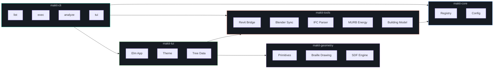

<p align="center">
  <picture>
    <source media="(prefers-color-scheme: dark)" srcset="docs/brand/makit-mark-dark.svg">
    
  </picture>
</p>

# makit

**A multi-tool CLI & TUI for AEC workflows** — orchestrate Revit, Blender, IFC analysis, and MURB energy modelling from one terminal.

<p align="center">
  
</p>
<p align="center"><sub>The TUI with a Revit sample model (<code>Ifc4_ARC.ifc</code>, not in the repo) and Toronto weather: load it in the IFC picker (it is extracted first), run <code>murb-simulate</code> with only the weather file typed, read the envelope and the results. Recorded with <a href="docs/media/makit-tui.tape">docs/media/makit-tui.tape</a>; the run's report page is in <a href="examples/MURB/Ifc4_ARC-in-Toronto/">examples/MURB/Ifc4_ARC-in-Toronto/</a>.</sub></p>

---

Built in Rust with [ratatui](https://ratatui.rs) for the interactive TUI and a dependency-free braille grid for terminal graphics. Makit bridges the gap between BIM authoring tools and programmatic analysis — connect to live applications, extract building geometry, run cross-platform analytics, simulate energy performance, and visualize results, all without leaving the terminal.

## Features

| Feature | Description |
|---------|-------------|
| **Interactive TUI** | ratatui tree explorer, option forms, an IFC picker that fills task inputs, braille previews that scale to the pane, Output pane for task logs, stop with `x`, mouse support |
| **Live Revit Bridge** | Extract walls, floors, rooms via pyRevit HTTP; run orientation & WWR analysis |
| **IFC Analysis** | Wall directions, window-to-wall ratio and the energy envelope (GFA by storey, walls above and below grade, windows, roof) from IFC files, no Revit needed: makit runs the Python extractor (IfcOpenShell) itself when an IFC has no extraction beside it or a stale one; it reads walls with their elevations, windows, curtain walls, storeys, floor plates and roofs with the file's units, and the analysis counts exterior walls only |
| **Blender Sync** | HTTP server that receives geometry from the Blender add-on (not drawn in the TUI yet) |
| **MURB Energy** | Monthly heat balance (TEDI / TEUI / GHGI) through murb_energy_tool, with every envelope area and the glazing split by facing taken from an IFC model unless you type them; a self-contained report page (the glass on a compass, the intensities against an even-glass run, the year, the envelope) and murb's own HTML report land beside the results JSON |
| **Braille Canvas** | Floor plans, elevations, bar charts, and data sheets in braille characters |
| **3D Logo** | The makit symbol on the TUI home screen: a braille kit of blocks with one block hovering above its socket |
| **Generic JSON Format** | Extract from any source into one schema, run the same analysis everywhere |

## Quick Start

### Build from Source

```bash
git clone https://github.com/winterweken/makit.git
cd makit
cargo build --release
```

### Launch the TUI

```bash
cargo run -p makit -- tui
# or just:
cargo run -p makit
```

| Key | Action |
|-----|--------|
| `↑ ↓` / `j k` | Move selection (`PgUp PgDn Home End` too) |
| `→ ←` / `l h` | Expand / collapse (← on a child jumps to its parent) |
| `Enter` | Open node · edit the focused option · load the highlighted IFC file |
| `e` | Execute the focused source or action (asks for any required option that has no value yet) |
| `x` | Stop the running task — only tasks that watch for it stop early (the Blender sync server does) |
| `Tab` / `Shift-Tab` | Cycle focus: Explorer → IFC files → Output |
| `o` | Toggle the Output pane (task `println!` output lands here) |
| `c` | Clear Output (when focused) |
| `?` | Toggle help overlay |
| `Esc` / `q` | Close help · quit |
| Mouse | Wheel scrolls the pane under the cursor · click selects / opens |

**Option values.** Expand a source or action to see its options. `Enter` on an option opens a one-line form (`Enter` saves, `Esc` cancels, `Ctrl-U` clears, an empty value restores the default); a leading `~` is expanded to your home directory. Values are kept for the session and passed to the task when you press `e`. The file loaded in the IFC picker fills `ifc --file`, `wall-orientation-wwr --input` and `murb-simulate --model` unless you type something else. Loading an IFC file extracts it first when it has no JSON beside it, or one older than the file, with a Python that has IfcOpenShell (`MAKIT_PYTHON`, the repository's `.venv`, or `python3`); the picker then shows its WWR and envelope figures.

**Previews.** Charts and drawings built from your data are titled plainly (`heating demand`, `wall area by orientation`); stock drawings are marked `· illustration`, and a chart with nothing to show stays empty (`· no results`). Load an IFC file in the picker and the `ifc` node draws its walls in isometric (`isometric`), exterior walls bright and interior walls dim, from the axes a format 3 extraction carries. When the pane is too short for a readable drawing, the preview is left out.

### CLI Commands

```bash
# List all registered tools, sources, and actions
makit list

# Execute a specific action
makit exec revit analysis revit-wall-orientations

# Extract an IFC file to JSON beside it. Needs a Python with IfcOpenShell (see
# Development); makit finds it through MAKIT_PYTHON, the repository's .venv or python3.
makit extract model.ifc

# Analyze an IFC file: WWR by direction and the energy envelope (GFA by storey,
# walls above and below grade, windows, roof). Extracts first when the JSON
# beside the file is missing or older than it.
makit analyze examples/IFC/Building-Architecture.ifc
makit analyze model.ifc -t envelope --grade -1.5   # grade in metres, project z

# Run a MURB energy simulation from a model (needs the murb repository on
# PYTHONPATH). Every envelope area and the glazing split by facing come from the
# IFC file or its extraction; a typed value wins over the model. The run is named
# after the model and the weather station ("model in Toronto"); the results go to
# murb_results.json (-o output=…), the report page to murb_results.html and murb's
# own HTML report to results/<run>/ beside it. A second run with the glass spread
# evenly gives the page its comparison.
PYTHONPATH=../murb makit exec murb analysis murb-simulate \
  -o model=path/to/model.ifc -o epw=weather.epw

# Rebuild the report page from a results file
makit exec murb reporting murb-report -o input=murb_results.json -o format=html

# Override anything. window-directions splits the glazing by facing: azimuth
# (degrees clockwise from north, or N/NE/E/SE/S/SW/W/NW) and share in any unit;
# without it and without a model, 25% each way.
PYTHONPATH=../murb makit exec murb analysis murb-simulate \
  -o epw=weather.epw -o gfa=299.3 -o walls-ag=345.7 -o walls-bg=77 -o windows=65.2 \
  -o roof=137.4 -o window-directions=SE:68,SW:20,NE:12

# Show help
makit --help
```

### Canvas Demo

```bash
cargo run -p makit --example canvas_demo
```

Renders braille-character shapes, a floor plan with interior walls, and filled rectangles — straight in the terminal.

---

## Architecture



### Workspace Layout

```
makit/
├── crates/
│   ├── makit-cli/           # Binary — clap CLI (list, exec, analyze, extract, tui, status, init)
│   ├── makit-core/          # Registry singleton, config (figment/YAML), model types
│   ├── makit-geometry/      # Point, Line, Rectangle + Plotter/BrailleGrid drawing + SDF
│   ├── makit-tools/         # Tool implementations (revit, blender, ifc, murb)
│   └── makit-tui/           # ratatui TUI (tree explorer, braille previews, output pane)
├── pyrevit-extension/       # Python pyRevit extension (runs inside Revit) + IFC extractor
│   └── tests/               # Extractor and analysis tests
├── scripts/
│   ├── blender/             # Python Blender addon
│   ├── murb_runner.py       # Python bridge for MURB energy tool
│   └── tests/               # Runner tests
├── examples/IFC/            # Sample IFC file, three extractions and analysis scripts
├── examples/MURB/           # A complete murb-simulate run: results JSON, report page, murb's own report
└── docs/                    # Architecture docs, brand/ (the makit symbol), media/ (README GIF and its VHS tape)
```

### Module Status

Tools register **sources** (inputs and connections) and **actions** (operations) at startup; `makit list` shows them all. Where each one stands:

| Status | Meaning |
|--------|---------|
| **Working** | Runs end to end and was checked on real input |
| **Needs app** | Implemented against another application's API; checked only when that application runs |
| **Partial** | Works, with a gap noted |
| **Placeholder** | Registered, but only prints a line (and reports success) |

<table>
<tr><th>Module</th><th>Status</th><th>Notes</th></tr>
<tr><td colspan="3"><b>Crates</b></td></tr>
<tr><td><code>makit-cli</code></td><td>Partial</td><td><code>list</code>, <code>exec</code>, <code>analyze</code> and <code>tui</code> work. <code>status</code> and <code>init</code> only print a line.</td></tr>
<tr><td><code>makit-core</code></td><td>Working</td><td>Registry, YAML config, task models and cancel tokens.</td></tr>
<tr><td><code>makit-geometry</code></td><td>Working</td><td>Primitives, <code>Plotter</code> drawing, braille grid, recordings, SDF engine. No external dependencies.</td></tr>
<tr><td><code>makit-tui</code></td><td>Working</td><td>Explorer, option forms, IFC picker, previews, Output pane, stop, mouse, terminal restore on signals.</td></tr>
<tr><td colspan="3"><b>IFC</b></td></tr>
<tr><td>IFC extractor (<code>analyze_ifc.py</code>, Python)</td><td>Working</td><td>Walls with their elevations, windows, curtain walls, storeys, floor plates (footprint union per storey) and roofs (up-facing surface) with the file's units, outward facing, true north and exterior flags. Needs IfcOpenShell; makit runs it on demand.</td></tr>
<tr><td><code>ifc</code> source</td><td>Working</td><td>Extracts an IFC file to JSON beside it with the Python extractor (<code>makit extract</code> on the command line). The picker, <code>makit analyze</code>, <code>wall-orientation-wwr</code> and <code>murb-simulate</code> extract on their own when the JSON is missing or older than the IFC, and keep a stale JSON with a note when no Python with IfcOpenShell is found.</td></tr>
<tr><td><code>wall-orientation-wwr</code></td><td>Working</td><td>Direction table and WWR for exterior walls, from an extraction JSON or an IFC file (extracted on demand).</td></tr>
<tr><td colspan="3"><b>Energy</b></td></tr>
<tr><td><code>murb-simulate</code></td><td>Working</td><td>Monthly TEDI / TEUI / GHGI through murb_energy_tool (put the murb repository on <code>PYTHONPATH</code>). Envelope areas (GFA by storey, walls above and below <code>--grade</code>, windows, roof) and window directions from an IFC model, each printed with its source; typed values win. Writes the results JSON, the report page (<code>&lt;output stem&gt;.html</code>, with a second even-glass run for its comparison) and murb's own HTML report (<code>results/&lt;run&gt;/</code>) beside it. Checked with Toronto TMYx weather on the three sample models.</td></tr>
<tr><td><code>murb-report</code></td><td>Working</td><td>Prints a results JSON as a report (<code>text</code>, <code>json</code>) or rebuilds the report page from it (<code>html</code>).</td></tr>
<tr><td><code>murb</code> source</td><td>Partial</td><td>Checks that murb_energy_tool imports, but reports success either way.</td></tr>
<tr><td colspan="3"><b>Revit</b> (pyRevit HTTP on port 48884)</td></tr>
<tr><td><code>revit-extract-walls</code>, <code>-floors</code>, <code>-rooms</code>, <code>revit-wall-orientations</code>, <code>revit-calculate-areas</code></td><td>Needs app</td><td>Call the pyRevit extension's endpoints. Without Revit they stop with a connection error.</td></tr>
<tr><td><code>revit</code> source</td><td>Partial</td><td>Connection check; reports success even when Revit is not reachable.</td></tr>
<tr><td><code>revit-find-clashes</code>, <code>revit-validate-standards</code></td><td>Placeholder</td><td>Print "Not yet implemented".</td></tr>
<tr><td>pyRevit extension</td><td>Needs app</td><td>Runs inside Revit. Does not set <code>isExternal</code> yet, so Revit extractions count every wall.</td></tr>
<tr><td colspan="3"><b>Blender, Rhino, rendering</b></td></tr>
<tr><td><code>blender</code> source</td><td>Partial</td><td>Geometry sync server (<code>/health</code>, <code>/geometry</code>) that <code>x</code> stops cleanly. Received geometry is kept, but nothing draws it yet. The add-on (<code>scripts/blender/makit_connector.py</code>) was not checked here.</td></tr>
<tr><td><code>rhino</code>, <code>rhino-import-revit</code>, <code>rhino-run-definition</code></td><td>Placeholder</td><td>Print a line only.</td></tr>
<tr><td><code>architect-render-demo</code></td><td>Placeholder</td><td>Prints a line only.</td></tr>
</table>

### Key Dependencies

| Crate | Purpose |
|-------|---------|
| [ratatui](https://ratatui.rs) 0.29 + [crossterm](https://docs.rs/crossterm) 0.28 | TUI widgets, braille canvas, terminal backend |
| [clap](https://docs.rs/clap) 4 | CLI argument parsing |
| [figment](https://docs.rs/figment) | Config management (YAML + env) |
| [reqwest](https://docs.rs/reqwest) | HTTP client for pyRevit bridge |
| [axum](https://docs.rs/axum) | HTTP server for Blender sync |
| [tokio](https://docs.rs/tokio) | Async runtime |

---

## Development

```bash
# Build
cargo build

# Run all 342 tests (3 cli, 10 core, 40 geometry, 98 tools, 191 tui). They read the
# three committed extractions in examples/IFC and need no Python.
cargo test

# Python IFC extractor: set up once, then run its 50 tests. makit finds this
# Python on its own (MAKIT_PYTHON, then .venv/bin/python, then python3).
uv venv .venv --python 3.13 && uv pip install --python .venv/bin/python ifcopenshell
.venv/bin/python -m unittest discover -s pyrevit-extension/tests

# MURB runner tests (3, no extra packages)
python3 -m unittest discover -s scripts/tests

# Run the CLI
cargo run -p makit -- --help

# Run the TUI
cargo run -p makit -- tui

# Run the canvas demo
cargo run -p makit --example canvas_demo

# Format & lint
cargo fmt
cargo clippy
```

### TUI Architecture

The TUI follows the **Elm architecture** pattern:

```
AppState → view(frame, state) → ratatui Frame → terminal (stderr)
   ↑                                                  |
   └── update(state, msg) → Vec<Cmd> ← keymap ← input ┘
                    │                         ↑
                    └→ runtime: worker threads ┘ (TaskFinished, IfcLoaded, MurbLoaded, Output)
```

- **`AppState`** (`app.rs`) — plain data: tree, focus, running tasks, option values, the open option form, Output log, IFC picker, viewport
- **`Msg` / `Cmd`** (`msg.rs`) — events in (keys, mouse, ticks, worker results) and side effects out (`RunTask`, `StopTask`, `LoadIfc`, `LoadMurb`, `Quit`)
- **`update`** (`update.rs`) — pure: no I/O, no global registry; returns commands for the runtime. Option metadata comes from a `Catalog` (`options.rs`) copied out of the registry at startup
- **`view`** (`view.rs`) — renders from state; shares `layout::compute` with mouse hit-testing
- **`runtime`** (`runtime.rs`) — event loop; runs tasks and loads on named worker threads, hands each task a `CancelToken`, and expands `~` in typed values
- The TUI draws on **stderr** and redirects **stdout** into the Output pane (`capture.rs`), so task handlers that `println!` never corrupt the screen. A task's result travels the same pipe as its output, so "✓ Success" always lands after the task's last line
- `SIGTERM` / `SIGHUP` / `SIGINT` restore the terminal before the process dies (`signals.rs`). If the event loop cannot answer within half a second — the terminal window was closed, say — a watchdog thread ends the process anyway. Without a terminal on stdin and stderr the TUI refuses to start and says why

---

## License

MIT
