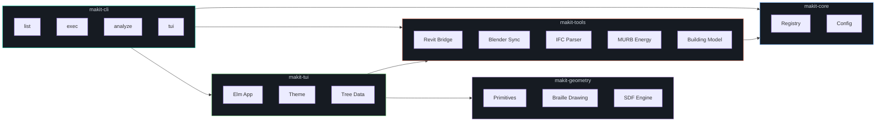

<p align="center">
  <picture>
    <source media="(prefers-color-scheme: dark)" srcset="docs/brand/makit-mark-dark.svg">
    
  </picture>
</p>

# makit

**A multi-tool CLI & TUI for AEC workflows** — orchestrate Revit, Blender, IFC analysis, and MURB energy modelling from one terminal.

```
╔══════════════════════════════════════════════════╗
║                makit canvas demo                 ║
╚══════════════════════════════════════════════════╝

▸ Isometric building:
⠀⠀⠀⠀⠀⠀⠀⠀⠀⠀⣀⣄⡀⠀⠀
⠀⠀⠀⠀⠀⠀⢀⠤⠒⣉⠤⡧⢌⣑⣢
⠀⠀⠀⠀⠀⠀⢸⣛⣛⣤⡶⠷⢮⣭⣽
⠀⠀⠀⠀⠀⠀⠸⣿⣉⠒⡗⢊⣡⡼⠟
⠀⠀⠀⠀⠀⠀⠀⠀⠉⠛⠟⠋⠁⠀⠀

▸ Floor plan:
⠀⠀⠀⠀⠀⠀⠀⠀⠀⠀⡀⠀⠀⠀⠀⠀⠀⠀⠀⠀⠀⠀⠀
⠀⠀⠀⠀⠀⠀⠀⠀⠀⠜⡟⠄⠀⠀⠀⠀⠀⠀⠀⠀⠀⠀⠀
⠀⡖⠒⠒⠒⠒⠒⠒⠒⠒⡖⠒⠒⠒⠒⠒⠒⠒⠒⡆⠀⠀⠀
⠀⡇⠀⠀⠀⠀⠀⠀⠀⠀⡇⠀⠀⠀⠀⠀⠀⠀⠀⡇⠀⠀⠀
⠀⡇⠀⠀⠀⠀⠀⠀⠀⠀⡆⠀⠀⠀⠀⠀⠀⠀⠀⡇⠀⠀⠀
⠀⡗⠒⠒⠒⠒⠒⠒⠒⠒⡗⠒⠒⠒⠒⠒⠒⠒⠂⡇⣐⣤⡀
⠀⡇⠀⠀⠀⠀⠀⠀⠀⠀⡇⠀⠀⠀⠀⠀⠀⠀⠀⡇⠐⠉⠀
⠀⡇⠀⠀⠀⠀⠀⠀⠀⠀⡇⠀⠀⠀⠀⠀⠀⠀⠀⡇⠀⠀⠀
⠀⡇⠀⠀⠀⠀⠀⠀⠀⠀⡇⠀⠀⠀⠀⠀⠀⠀⠀⡇⠀⠀⠀
⠀⠓⠒⠒⠒⠒⠒⠒⠒⠒⠓⠒⠒⠒⠒⠒⠒⠒⠒⠃⠀⠀⠀

▸ Energy (heating demand):
⡀⠀⠀⠀⠀⠀⠀⠀⠀⠀⠀⠀⠀⠀⠀⠀⠀⠀⠀⠀⠀
⡇⣀⡀⠀⠀⠀⠀⠀⠀⠀⠀⠀⠀⠀⠀⠀⠀⠀⠀⠀⠀
⡇⣿⣇⣀⠀⠀⠀⠀⠀⠀⠀⠀⠀⠀⠀⠀⠀⢰⣶⠀⠀
⡇⣿⣿⣿⠀⠀⠀⠀⠀⠀⠀⠀⠀⠀⠀⠀⣶⣾⣿⠀⠀
⡇⣿⣿⣿⣶⡆⠀⠀⠀⠀⠀⠀⠀⠀⠀⠀⣿⣿⣿⠀⠀
⡇⣿⣿⣿⣿⡇⠀⠀⠀⠀⠀⠀⠀⠀⢰⣶⣿⣿⣿⠀⠀
⡇⣿⣿⣿⣿⣷⣶⠀⠀⠀⠀⠀⠀⠀⢸⣿⣿⣿⣿⠀⠀
⡇⣿⣿⣿⣿⣿⣿⣤⡄⠀⠀⠀⠀⣶⣾⣿⣿⣿⣿⠀⠀
⣇⣿⣿⣿⣿⣿⣿⣿⣷⣶⣤⣴⣶⣿⣿⣿⣿⣿⣿⣀⡀
 J  F  M  A  M  J  J  A  S  O  N  D
```

---

Built in Rust with [ratatui](https://ratatui.rs) for the interactive TUI and a dependency-free braille grid for terminal graphics. Makit bridges the gap between BIM authoring tools and programmatic analysis — connect to live applications, extract building geometry, run cross-platform analytics, simulate energy performance, and visualize results, all without leaving the terminal.

## Features

| Feature | Description |
|---------|-------------|
| **Interactive TUI** | ratatui tree explorer, braille previews that scale to the pane, Output pane for task logs, mouse support |
| **Live Revit Bridge** | Extract walls, floors, rooms via pyRevit HTTP; run orientation & WWR analysis |
| **IFC Analysis** | Standalone wall orientation and Window-to-Wall Ratio analysis (no Revit required) |
| **Blender Sync** | Receive live geometry from Blender over HTTP for TUI visualization |
| **MURB Energy** | Monthly heat balance simulation — TEDI / TEUI / GHGI analysis via Python bridge |
| **Braille Canvas** | Floor plans, elevations, bar charts, and data sheets in braille characters |
| **3D Logo** | The makit symbol on the TUI home screen: a braille kit of blocks with one block hovering above its socket |
| **Generic JSON Format** | Extract from any source into one schema, run the same analysis everywhere |

## Quick Start

### Build from Source

```bash
git clone https://github.com/winterweken/makit.git
cd makit
cargo build --release
```

### Launch the TUI

```bash
cargo run -p makit -- tui
# or just:
cargo run -p makit
```

| Key | Action |
|-----|--------|
| `↑ ↓` / `j k` | Move selection (`PgUp PgDn Home End` too) |
| `→ ←` / `l h` | Expand / collapse (← on a child jumps to its parent) |
| `Enter` | Open node · edit the focused option · load the highlighted IFC file |
| `e` | Execute the focused source or action (asks for any required option that has no value yet) |
| `x` | Stop the running task — only tasks that watch for it stop early (the Blender sync server does) |
| `Tab` / `Shift-Tab` | Cycle focus: Explorer → IFC files → Output |
| `o` | Toggle the Output pane (task `println!` output lands here) |
| `c` | Clear Output (when focused) |
| `?` | Toggle help overlay |
| `Esc` / `q` | Close help · quit |
| Mouse | Wheel scrolls the pane under the cursor · click selects / opens |

**Option values.** Expand a source or action to see its options. `Enter` on an option opens a one-line form (`Enter` saves, `Esc` cancels, `Ctrl-U` clears, an empty value restores the default); a leading `~` is expanded to your home directory. Values are kept for the session and passed to the task when you press `e`. The file loaded in the IFC picker fills `ifc --file` and `wall-orientation-wwr --input` unless you type something else.

**Previews.** Charts and drawings built from your data are titled plainly (`heating demand`, `wall area by orientation`); stock drawings are marked `· illustration`, and a chart with nothing to show stays empty (`· no results`). When the pane is too short for a readable drawing, the preview is left out.

### CLI Commands

```bash
# List all registered tools, sources, and actions
makit list

# Execute a specific action
makit exec revit analysis revit-wall-orientations

# Analyze an IFC file
makit analyze examples/IFC/Building-Architecture.ifc

# Run a MURB energy simulation (needs the murb repository on PYTHONPATH).
# window-directions splits the glazing by facing: azimuth (degrees clockwise
# from north, or N/NE/E/SE/S/SW/W/NW) and share in any unit; default 25% each way.
PYTHONPATH=../murb makit exec murb analysis murb-simulate \
  -o epw=weather.epw -o gfa=335.5 -o walls-ag=307.4 -o windows=182.8 -o roof=244.3 \
  -o window-directions=SE:68,SW:20,NE:12

# Show help
makit --help
```

### Canvas Demo

```bash
cargo run -p makit --example canvas_demo
```

Renders braille-character shapes, a floor plan with interior walls, and filled rectangles — straight in the terminal.

---

## Architecture



### Workspace Layout

```
makit/
├── crates/
│   ├── makit-cli/           # Binary — clap CLI (list, exec, analyze, tui, status, init)
│   ├── makit-core/          # Registry singleton, config (figment/YAML), model types
│   ├── makit-geometry/      # Point, Line, Rectangle + Plotter/BrailleGrid drawing + SDF
│   ├── makit-tools/         # Tool implementations (revit, blender, ifc, murb)
│   └── makit-tui/           # ratatui TUI (tree explorer, braille previews, output pane)
├── pyrevit-extension/       # Python pyRevit extension (runs inside Revit)
├── scripts/
│   ├── blender/             # Python Blender addon
│   └── murb_runner.py       # Python bridge for MURB energy tool
├── examples/IFC/            # Sample IFC files and analysis scripts
└── docs/                    # Architecture documentation
```

### Tool Registry

Tools register **sources** (geometry input drivers) and **actions** (operations) at startup:

<table>
<tr><th>Source</th><th>Description</th></tr>
<tr><td><code>revit</code></td><td>Autodesk Revit via pyRevit HTTP bridge (port 48884)</td></tr>
<tr><td><code>blender</code></td><td>Blender live geometry sync (axum server)</td></tr>
<tr><td><code>ifc</code></td><td>IFC file loader + IfcOpenShell extraction</td></tr>
<tr><td><code>murb</code></td><td>MURB energy modelling (Python subprocess)</td></tr>
<tr><td><code>rhino</code></td><td>Rhino 3D / Grasshopper integration</td></tr>
</table>

<table>
<tr><th>Action</th><th>Category</th><th>Description</th></tr>
<tr><td><code>revit-extract-walls</code></td><td>extraction</td><td>Extract wall elements from Revit</td></tr>
<tr><td><code>revit-wall-orientations</code></td><td>analysis</td><td>Wall orientation + WWR analysis</td></tr>
<tr><td><code>murb-simulate</code></td><td>analysis</td><td>Monthly energy simulation</td></tr>
<tr><td><code>murb-report</code></td><td>reporting</td><td>TEDI / TEUI / GHGI report</td></tr>
<tr><td><code>architect-render-demo</code></td><td>rendering</td><td>Architectural demo rendering</td></tr>
<tr><td colspan="3"><em>12 actions total — run <code>makit list</code> to see all</em></td></tr>
</table>

### Key Dependencies

| Crate | Purpose |
|-------|---------|
| [ratatui](https://ratatui.rs) 0.29 + [crossterm](https://docs.rs/crossterm) 0.28 | TUI widgets, braille canvas, terminal backend |
| [clap](https://docs.rs/clap) 4 | CLI argument parsing |
| [figment](https://docs.rs/figment) | Config management (YAML + env) |
| [reqwest](https://docs.rs/reqwest) | HTTP client for pyRevit bridge |
| [axum](https://docs.rs/axum) | HTTP server for Blender sync |
| [tokio](https://docs.rs/tokio) | Async runtime |

---

## Development

```bash
# Build
cargo build

# Run all 274 tests (10 core, 40 geometry, 42 tools, 182 tui)
cargo test

# Python IFC extractor: set up once, then run its tests
uv venv .venv --python 3.13 && uv pip install --python .venv/bin/python ifcopenshell
.venv/bin/python -m unittest discover -s pyrevit-extension/tests

# Run the CLI
cargo run -p makit -- --help

# Run the TUI
cargo run -p makit -- tui

# Run the canvas demo
cargo run -p makit --example canvas_demo

# Format & lint
cargo fmt
cargo clippy
```

### TUI Architecture

The TUI follows the **Elm architecture** pattern:

```
AppState → view(frame, state) → ratatui Frame → terminal (stderr)
   ↑                                                  |
   └── update(state, msg) → Vec<Cmd> ← keymap ← input ┘
                    │                         ↑
                    └→ runtime: worker threads ┘ (TaskFinished, IfcLoaded, MurbLoaded, Output)
```

- **`AppState`** (`app.rs`) — plain data: tree, focus, running tasks, option values, the open option form, Output log, IFC picker, viewport
- **`Msg` / `Cmd`** (`msg.rs`) — events in (keys, mouse, ticks, worker results) and side effects out (`RunTask`, `StopTask`, `LoadIfc`, `LoadMurb`, `Quit`)
- **`update`** (`update.rs`) — pure: no I/O, no global registry; returns commands for the runtime. Option metadata comes from a `Catalog` (`options.rs`) copied out of the registry at startup
- **`view`** (`view.rs`) — renders from state; shares `layout::compute` with mouse hit-testing
- **`runtime`** (`runtime.rs`) — event loop; runs tasks and loads on named worker threads, hands each task a `CancelToken`, and expands `~` in typed values
- The TUI draws on **stderr** and redirects **stdout** into the Output pane (`capture.rs`), so task handlers that `println!` never corrupt the screen. A task's result travels the same pipe as its output, so "✓ Success" always lands after the task's last line
- `SIGTERM` / `SIGHUP` / `SIGINT` restore the terminal before the process dies (`signals.rs`). If the event loop cannot answer within half a second — the terminal window was closed, say — a watchdog thread ends the process anyway. Without a terminal on stdin and stderr the TUI refuses to start and says why

---

## License

MIT
